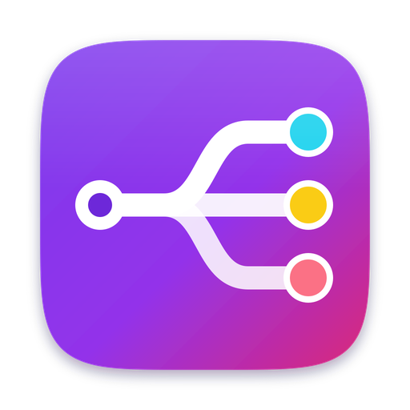
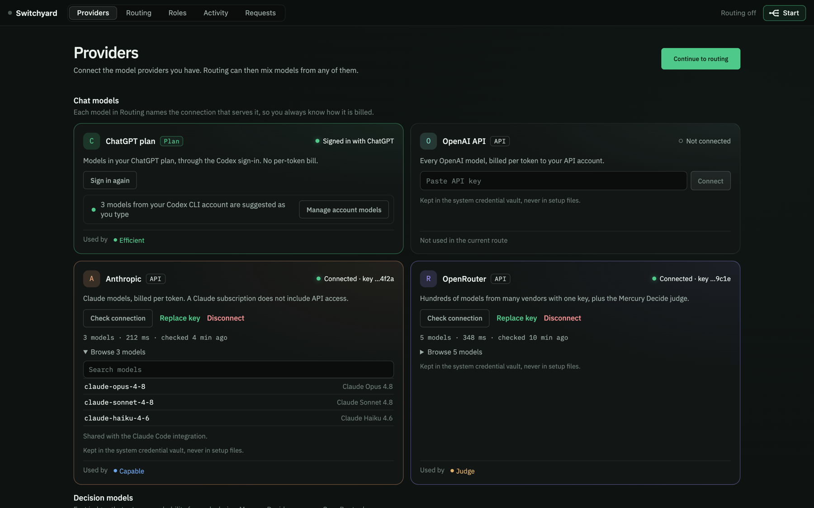
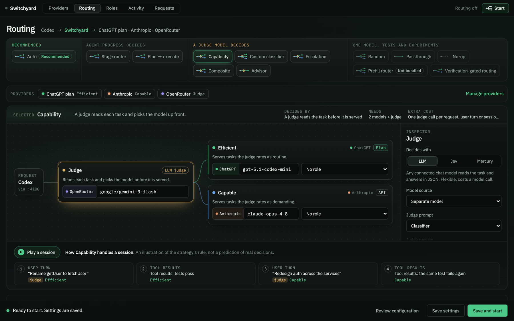
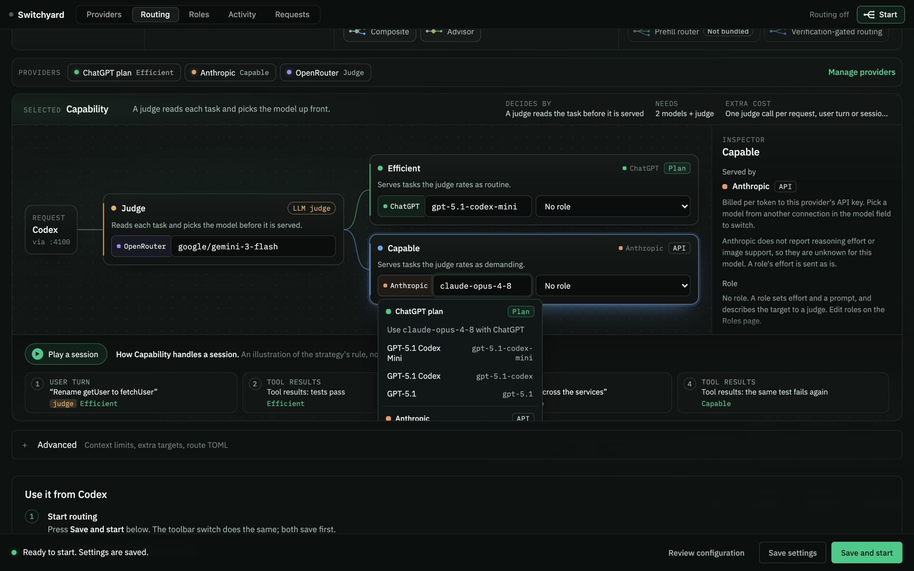
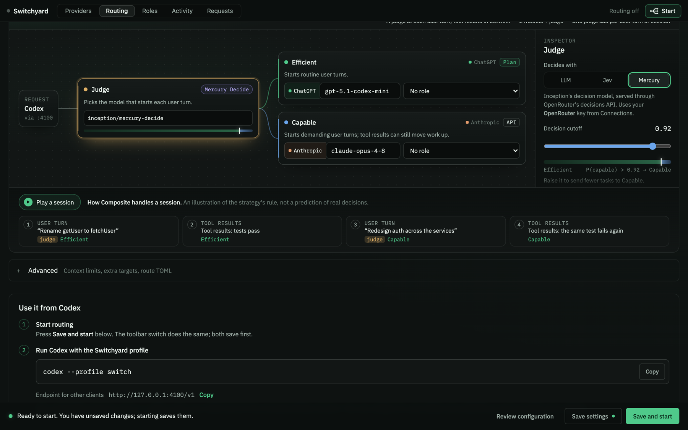
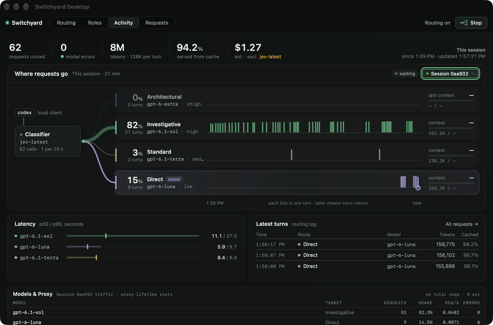
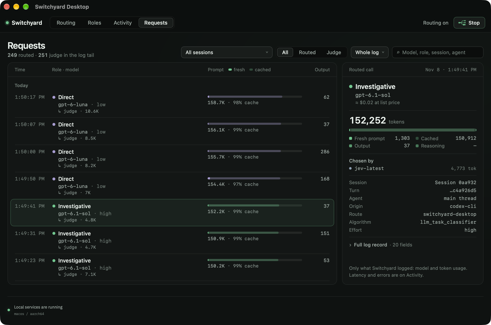

<div align="center">



# Switchyard Desktop

**Route every AI request to the right model, automatically.**<br>
Lighter models for routine work, more capable ones when it matters, with no manual switching.

[](#run-on-macos)
[](#run-on-macos)
[](desktop/README.md)
[](LICENSE)

[Run it](#run-on-macos) · [Providers](#connect-providers-then-route) · [Codex](#start-routing-codex) · [Claude Code](#use-claude-code-with-an-anthropic-api-key) · [Migrate](#existing-installations) · [Status](#development-and-limitations)

</div>

<br>

The app uses [NVIDIA Switchyard](https://github.com/NVIDIA-NeMo/Switchyard) through
an independently maintained [core fork](https://github.com/eugenn/Switchyard).
It is not affiliated with NVIDIA, OpenAI or Anthropic. The only application lives in
[`desktop/`](desktop/README.md), built with Tauri, React and Rust; its source,
runtime inputs, resources and build tools are all there.

## Connect providers, then route

<table>
  <tr>
    <td width="50%"></td>
    <td width="50%"></td>
  </tr>
  <tr>
    <td valign="top"><b>Providers</b><br>Connect the providers you have: the ChatGPT plan by sign-in, or API keys for OpenAI, Anthropic and OpenRouter. Each card shows its status, the last characters of the key, a free connection check with the model list, and which models in the route use it. Keys stay in the system credential vault.</td>
    <td valign="top"><b>Routing</b><br>Pick a strategy and see the route as a live diagram: Request, then a rule or a task judge, then the model slots. One route can mix providers, here Efficient on the ChatGPT plan, Capable on Anthropic and the judge on OpenRouter. <b>Play a session</b> walks through how the strategy decides, step by step.</td>
  </tr>
  <tr>
    <td width="50%"></td>
    <td width="50%"></td>
  </tr>
  <tr>
    <td valign="top"><b>Model picker</b><br>Every model field lists models from all connected providers, grouped by connection, with a <b>Plan</b> or <b>API</b> badge so you can see how each model is billed. Typed model IDs work too.</td>
    <td valign="top"><b>Task judge</b><br>A judge can be any connected chat model, or a decision model: Jev through TypeSafe, or Mercury Decide through OpenRouter. The cutoff slider shows when a task moves from Efficient to Capable.</td>
  </tr>
</table>

## See where your requests go

<table>
  <tr>
    <td width="50%"></td>
    <td width="50%"></td>
  </tr>
  <tr>
    <td valign="top"><b>Activity</b><br>How requests in the selected session were distributed across routing roles and models, with latency, cache hits and estimated API cost.</td>
    <td valign="top"><b>Requests</b><br>Filter the routing log and inspect the model, classifier decision, and fresh, cached and output token counts for each request.</td>
  </tr>
</table>

## What you can connect

| Integration | How it works | What you need |
| --- | --- | --- |
| Codex / ChatGPT plan | Codex sends requests to the local Switchyard server, which selects a model and calls the bundled LiteLLM gateway for models in your plan. | Codex CLI, account access to the chosen models, and a separate ChatGPT sign-in on the Providers page. |
| OpenAI, Anthropic, OpenRouter API | Models chosen from these connections are called directly with your API key, billed per token. One route can mix them with the ChatGPT plan. | An API key for each provider you use, saved on the Providers page. A Claude subscription does not include API access. |
| Claude Code | Claude Code sends requests to the local Switchyard server, which selects between two Claude models and calls Anthropic with your API key. | Claude Code, an Anthropic API key (billed to your API account, not a Claude subscription) and access to both models. Development preview; live-key testing still needed. |
| Jev / TypeSafe, Mercury Decide | Optional decision models that help choose the model; they do not write the final answer. | A TypeSafe API key for Jev, or your OpenRouter key for Mercury Decide. Classification requests are separate from your model usage. |

Claude Code uses the same local server as Codex but its own Claude route, so its
requests also appear in Activity. There is no Claude subscription sign-in: the app
never handles Claude Code tokens. Gemini and local models have no connection in this app yet.
Supported models and usage limits depend on your provider.

## Run on macOS

You need macOS 14+, Node.js 22+, Rust stable, Xcode Command Line Tools, Python 3
and `uv`. The bundled Switchyard source also needs the toolchain specified in
`vendor/switchyard/rust-toolchain.toml`.

From the repository root, open Terminal and run:

```sh
cd desktop
npm ci
npm run runtime
npm run desktop
```

The first preparation builds Switchyard and bundles Python/LiteLLM. It can take
some time and requires dependency downloads. The app does not install packages
when it starts. If a prepared runtime already exists, the preparation command
refuses to replace it; see [runtime preparation](desktop/README.md#run-on-macos).

`npm run dev` only opens a browser preview. Account sign-in, routing and other
native actions are disabled there. Use `npm run desktop` for a working app.

Windows setup is documented in [the application guide](desktop/README.md#windows-development).
It still needs native build and runtime acceptance on Windows.

## Start routing Codex

1. Install Codex CLI separately and sign in to the account you want to use.
2. On the app's **Providers** page, sign in with ChatGPT and load your account's
   models, and add API keys for any other providers you want to use.
3. On **Routing**, choose a strategy and pick a model for each slot from any
   connected provider. Review the generated configuration.
4. Save your settings and start routing. The status bar names any slot whose
   provider is not connected yet.
5. In your project folder, run:

   ```sh
   codex --profile switch
   ```

Keep the app running while using this route. Stop routing in the app when done.
The app temporarily creates `CODEX_HOME/switch.config.toml`; it does not rewrite
`config.toml` or overwrite an unrelated profile. A stale Switchyard profile or
a file containing only Codex UI state can be replaced on Start. An occupied port is
reported rather than freed by stopping someone else's process.

## Use Claude Code with an Anthropic API key

Claude Code is Anthropic's program for working with code in Terminal, separate
from the Claude website and desktop app. In **Routing > Set up Claude**, save your
Anthropic API key (it goes to the system credential vault and is the same key as
the Anthropic connection on **Providers**), choose two models,
start routing, and run the launch command the app shows. The server calls
Anthropic with your key; Claude Code never sees it. Usage is billed to your
Anthropic API account.

Follow the [step-by-step Claude guide](desktop/README.md#claude-code-routing-with-an-anthropic-api-key)
for setup, what is not verified yet and the Noop note for Claude-only use.

## Existing installations

Quit the retired app and stop its route before starting this one: both use ports
4100/4101. Do not delete account files or app data to upgrade. This app keeps its
settings under `switchyard-desktop/cross-platform` in the platform's application
data folder. That directory name is retained to preserve existing preview data.

To bring over an old routing setup, use **Import / export routing setup** and
paste your exported JSON or legacy `saved-routing-setup.json`. Import creates a
draft: review it and save explicitly. Accounts, tokens and request history are
not transferred. Old setup imports are tested with 29 synthetic fixtures.

## Development and limitations

The routing editor supports 13 strategies and 18 built-in roles. Some server
features, including Prefill, require an optional core build. Activity views,
forced-quit recovery, OS integration, credential protection and installer
acceptance still have open work. Removing the old app does not mean these gaps
are complete. See [current status](docs/cross-platform.md).

- [Application setup and checks](desktop/README.md)
- [Development workflow](docs/development.md)
- [Contributing](CONTRIBUTING.md)
- [Release requirements](docs/releases.md)
- [Core snapshot ownership](docs/core-fork.md)

## License

Original application code and assets are licensed under [Apache-2.0](LICENSE).
Third-party components retain their own licenses; see [NOTICE](NOTICE),
[dependency notices](desktop/resources/THIRD-PARTY-NOTICES.txt) and `desktop/licenses/`.
Report vulnerabilities using [SECURITY.md](SECURITY.md).
