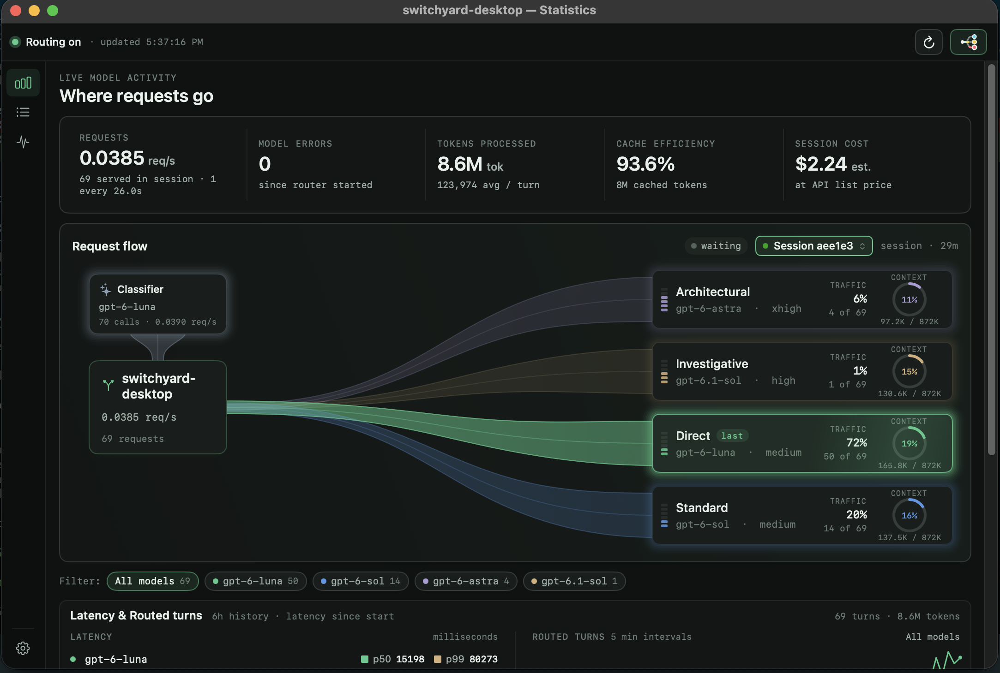

# switchyard-desktop

Native macOS app for routing AI requests between models with NVIDIA Switchyard.
The project's scope covers all providers supported by Switchyard. Codex is one
example of a client integration, rather than a requirement of the underlying
router. Configure models and routing, then review request statistics. Switchyard
and the Python/LiteLLM runtime are bundled with the app.

This is an independent community project using a
[maintained Switchyard fork](https://github.com/eugenn/Switchyard), based on
[NVIDIA Switchyard](https://github.com/NVIDIA-NeMo/Switchyard). It is not affiliated
with or endorsed by NVIDIA or OpenAI.



## Download

[Download the DMG for Apple Silicon (arm64)](https://github.com/eugenn/switchyard-desktop/releases/download/v0.1.0-preview.1/switchyard-desktop-0.1.0-1-arm64-local.dmg)
[](https://github.com/eugenn/switchyard-desktop/releases/tag/v0.1.0-preview.1)
— macOS 14 or later.

This is the **v0.1.0-preview.1 test prerelease**, ad-hoc signed without an Apple
Developer ID signature or Apple notarization. An Intel DMG is not available for
this preview. See the [release notes and known limitations](https://github.com/eugenn/switchyard-desktop/releases/tag/v0.1.0-preview.1)
and the [SHA-256 checksum](https://github.com/eugenn/switchyard-desktop/releases/download/v0.1.0-preview.1/switchyard-desktop-0.1.0-1-arm64-local.dmg.sha256).

## Providers and clients

Switchyard connects routes to upstream model providers; applications such as
Codex send requests to those routes. Provider credentials, available models, and
API compatibility depend on the chosen upstream and client. See the
[bundled Switchyard documentation](vendor/switchyard/README.md) for the core's
capabilities and configuration.

**Current preview limitation:** the desktop setup wizard currently configures
the Codex/ChatGPT integration. Anthropic Claude and Google Gemini are not yet
selectable in the wizard. Switchyard's broader provider support does not mean
every provider already has a setup flow in this preview.

## Install and launch

1. Download and open the DMG above, drag **switchyard-desktop.app** to
   **Applications**, and launch it. If macOS blocks the preview, follow
   [Opening the unnotarized preview](#opening-the-unnotarized-preview) below.
2. Open **Routing config** to configure a route. The example below walks through
   the integration available in the current preview.

### Example: route Codex requests

For this example, install the Codex CLI and sign in with access to the models
you want to use. These requirements apply to this integration.

1. In **Codex account**, discover your available models.
2. In **Routing**, choose an algorithm and assign models and roles.
3. In **Review & start**, review the configuration and start routing. Follow the
   ChatGPT sign-in instructions if prompted.
4. Run Codex through the route:

   ```sh
   codex --profile switch
   ```

Keep the app running while using the route. Use **Stop routing** when finished.

### Opening the unnotarized preview

Only approve the app if you trust this project and downloaded it from this
repository's GitHub Releases. Apple has not notarized this test build.

1. In **Applications**, try opening **switchyard-desktop.app** once. If macOS
   says the developer cannot be verified or Apple cannot check the app for
   malicious software, dismiss the alert without moving the app to Trash.
2. Open **System Settings → Privacy & Security** and scroll to **Security**.
3. Find the message about **switchyard-desktop** and click **Open Anyway**.
4. Confirm with **Open** when prompted. Subsequent launches normally work by
   double-clicking the app.

This adds an exception for this app. There is no need to disable Gatekeeper
globally or run Terminal commands. If macOS instead reports malware or a damaged
app, stop rather than bypassing that warning. On a managed Mac, your
administrator may restrict these options.

See Apple's [instructions for opening apps that haven't been notarized](https://support.apple.com/en-us/102445).

## Run from source

Requires Xcode, Python 3, `uv`, and the Rust toolchain specified in
`vendor/switchyard/rust-toolchain.toml`. From the repository root:

```sh
export DEVELOPER_DIR=/Applications/Xcode.app/Contents/Developer
./scripts/build-dev-app.sh release
open build/switchyard-desktop.app
```

Then follow the setup steps above. The build downloads and bundles the required
runtimes; nothing is installed at app startup.

## Development and contributions

The app builds from the checked-in core snapshot; a separate core checkout is
only needed to develop server changes. Start with [CONTRIBUTING.md](CONTRIBUTING.md)
and the [development workflow](docs/development.md). See also
[core fork maintenance](docs/core-fork.md), [releases and provenance](docs/releases.md),
and [GitHub maintainer settings](docs/github.md).

## License

Original application code and project assets are licensed under
[Apache-2.0](LICENSE). Third-party components retain their own licenses; see
[NOTICE](NOTICE) and [third-party notices](Resources/THIRD-PARTY-NOTICES.txt).
Report vulnerabilities using [SECURITY.md](SECURITY.md).
